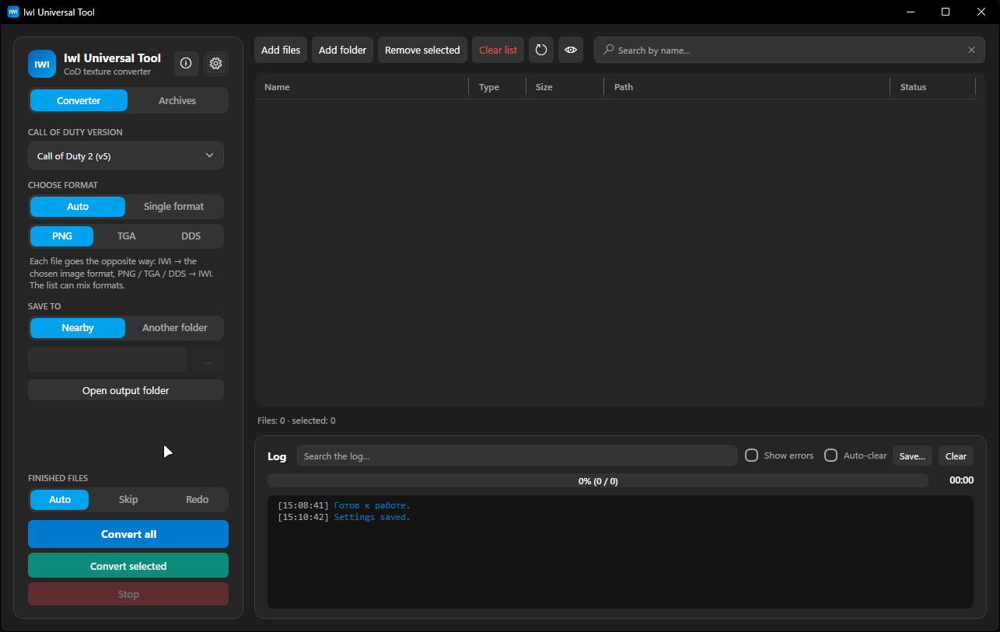
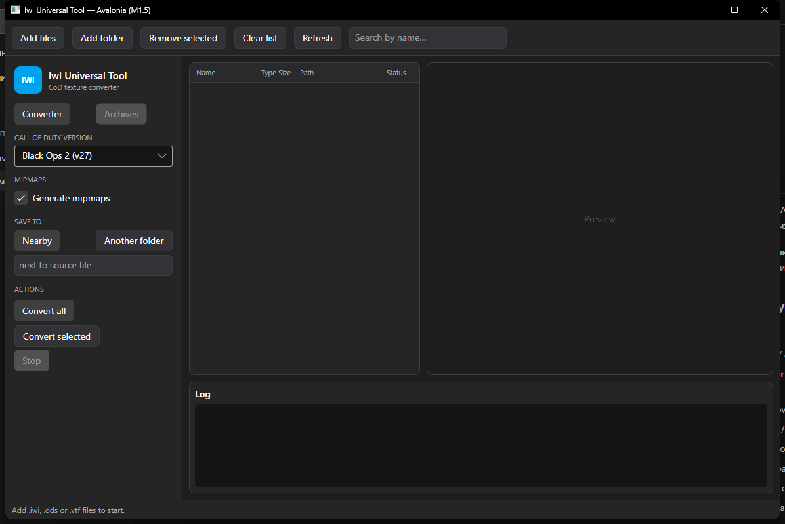

# IwI Universal Tool

[English](README.md) | [Русский](README.ru.md)

A Windows utility for Call of Duty textures: preview, conversion, packing/unpacking game archives, and Explorer thumbnails.

> Unofficial project. Not affiliated with Activision, Infinity Ward, Treyarch or Plutonium. No game assets are included in this repository.



## Features

- **Texture preview**: IWI, DDS, PNG, TGA, VTF — with zoom, alpha channel and format/mipmap info.
- **Conversion**: PNG/TGA/DDS ↔ IWI and DDS, including DXT1/DXT3/DXT5, BC5 and R8.
- **Call of Duty archives**: IWD (ZIP) and IPAK (Black Ops 2) — browse contents, replace textures, pack.
- **Replace a file in an archive**: double-click an archive entry, pick an external file, status shows “Will be replaced”.
- **Explorer thumbnails** for `.iwi` and `.vtf` (the `IwiThumbs` component, registered in HKLM).
- **Hotkeys**, including mouse buttons, with on/off toggles.
- **IWD recompression that never grows the archive**: only entries that actually get smaller are compressed.
- **IWI versions**: v5 (CoD2), v6 (CoD4/WaW/MW2), v8 (MW2/MW3), v13 (BO1), v27 (BO2), including mipmaps.
- **CoD4 wavelet textures** are decoded without an external `wavelet_tables.bin` — the tables are generated from a compact description in code.

## Requirements

**To run the published `.exe`:**

- Windows 10/11 x64.
- The `.exe` is self-contained, no .NET installation is required — **except** for Explorer thumbnails, which need the **.NET 10 Desktop Runtime**. The app offers to download it when you test thumbnails.

**To build:**

- .NET 10 SDK, or Visual Studio 2026 with the .NET Desktop workload.
- Windows x64.

## Build

```powershell
cd IwIUniversalTool
dotnet publish -c Release -r win-x64
```

Output — a single file:

```text
IwIUniversalTool\bin\Release\net10.0-windows\win-x64\publish\IwIUniversalTool.exe
```

See [BUILD.en.md](BUILD.en.md) for details.

## Linux / CLI

The GUI is Windows-only (WPF + Explorer COM integration). For Linux there is a small cross-platform **CLI converter** in `IwIUniversalTool.Cli` — no GUI and no Explorer thumbnails, but the codecs are the same.

A full Avalonia GUI port is planned; see [docs/LINUX-PORT.md](docs/LINUX-PORT.md).

```bash
# run from source (requires .NET 10 SDK)
dotnet run --project IwIUniversalTool.Cli -- info image.iwi
dotnet run --project IwIUniversalTool.Cli -- convert image.iwi
dotnet run --project IwIUniversalTool.Cli -- convert image.dds --game bo2

# self-contained Linux binary
dotnet publish IwIUniversalTool.Cli -c Release -r linux-x64 --self-contained true
# result: IwIUniversalTool.Cli/bin/Release/net10.0/linux-x64/publish/iwi-tool
```

Supported: `.iwi` → `.dds`, `.vtf` → `.dds`, `.dds` → `.iwi` with `--game cod2|cod4|waw|mw2|mw3|bo1|bo2`.

## Linux GUI (Avalonia, early preview)

The Windows app is WPF and cannot run on Linux. A cross-platform Avalonia port is in progress in `IwIUniversalTool.Avalonia`.

Current M1 preview:



- file list (add files/folder, remove, clear, search);
- texture preview for IWI/DDS/VTF;
- IWI → DDS, VTF → DDS, DDS → IWI;
- game/version selector, mipmap toggle, output folder, log and stop button.

Run it on **Windows** (to test the same UI without Linux):

```powershell
dotnet run --project IwIUniversalTool.Avalonia
```

Build for Linux:

```bash
dotnet publish IwIUniversalTool.Avalonia -c Release -r linux-x64 --self-contained true
```

The full port plan and milestones are in [docs/LINUX-PORT.md](docs/LINUX-PORT.md).

## Explorer thumbnails

1. Settings → “Thumbnails” → **Enable thumbnails** (requires administrator rights: writes to HKLM).
2. If the icons do not refresh — **Reset thumbnail cache and restart Explorer**.
3. The component needs the .NET 10 Desktop Runtime; the “Test thumbnails” button reports the error and offers the download link.

## Usage

1. Drag textures or a folder into the app window (or open a file via “Open”).
2. Double-click an archive entry to assign a replacement.
3. To pack: choose the game version, the archive and press “Pack”.

Settings are stored in `settings.json` next to the `.exe`; the thumbnail component is extracted to `%LOCALAPPDATA%\IwIUniversalTool` when needed.

## Limitations

- No bundled game assets: you need your own game files.
- Format support is community-driven and based on file analysis; some exotic IWI variants may not be readable.
- IPAK stores no texture names — entries are listed by hash.

## License

MIT — see [LICENSE](LICENSE).
