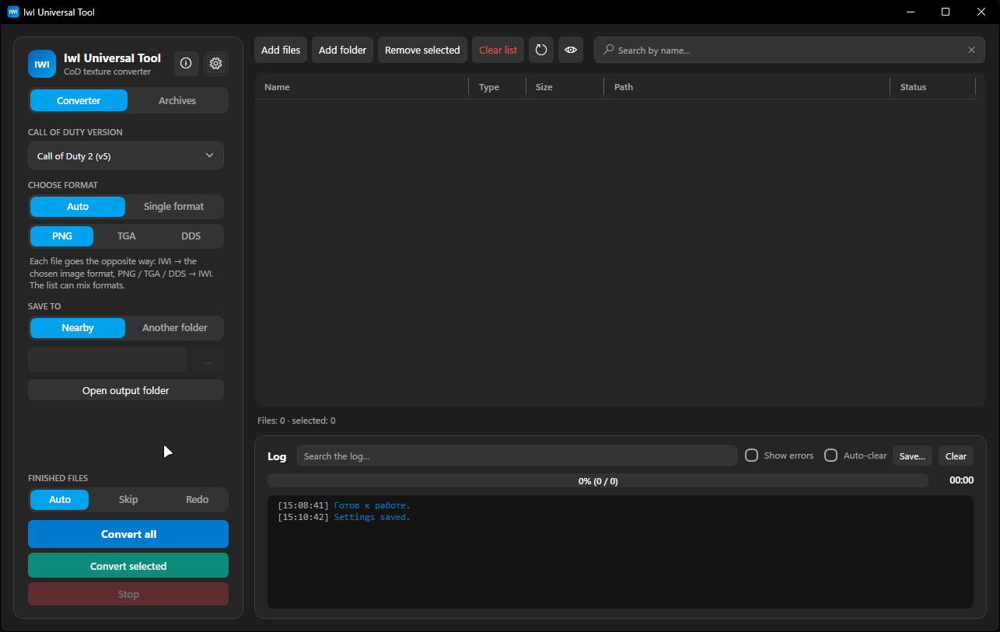

# IwI Universal Tool

[English](README.md) | [Русский](README.ru.md)

Утилита для работы с текстурами Call of Duty: просмотр, конвертация, упаковка и распаковка игровых архивов, миниатюры в Проводнике Windows.

> Неофициальный проект. Не связан с Activision, Infinity Ward, Treyarch и Plutonium. Игровые файлы в репозиторий не входят.



## Возможности

- **Просмотр текстур**: IWI, DDS, PNG, TGA, VTF — с зумом, альфа-каналом и информацией о формате/мипмапах.
- **Конвертация**: PNG/TGA/DDS ↔ IWI и DDS, включая DXT1/DXT3/DXT5, BC5 и R8.
- **Архивы Call of Duty**: IWD (ZIP) и IPAK (Black Ops 2) — просмотр содержимого, замена текстур, упаковка.
- **Замена файла в архиве**: двойной клик по файлу из архива, выбор внешнего файла, статус «Заменится».
- **Миниатюры в Проводнике** для `.iwi` и `.vtf` (компонент `IwiThumbs`, регистрируется в HKLM).
- **Горячие клавиши**, в том числе кнопки мыши, с включением/выключением.
- **Сжатие IWD** без роста архива: сжимаются только записи, которым это реально выгодно.
- **IWI-версии**: v5 (CoD2), v6 (CoD4/WaW/MW2), v8 (MW2/MW3), v13 (BO1), v27 (BO2), включая мипмапы.
- **Wavelet-текстуры CoD4** декодируются без внешнего `wavelet_tables.bin` — таблицы собираются из компактного описания в коде.

## Требования

**Для запуска готового `.exe`:**

- Windows 10/11 x64.
- Сам `.exe` самодостаточный, .NET ставить не нужно **кроме** миниатюр в Проводнике: для них нужен **.NET 10 Desktop Runtime**. Программа предложит скачать его при проверке миниатюр.

**Для сборки:**

- .NET 10 SDK или Visual Studio 2026 с рабочей нагрузкой .NET Desktop.
- Windows x64.

## Сборка

```powershell
cd IwIUniversalTool
dotnet publish -c Release -r win-x64
```

Результат — один файл:

```text
IwIUniversalTool\bin\Release\net10.0-windows\win-x64\publish\IwIUniversalTool.exe
```

Подробнее — в [BUILD.md](BUILD.md).

## Linux / CLI

Графический интерфейс — только Windows (WPF + COM Проводника). Для Linux есть небольшой **кроссплатформенный CLI-конвертер** в `IwIUniversalTool.Cli`: без GUI и миниатюр, но с теми же кодеками.

Полный порт GUI на Avalonia запланирован; план — в [docs/LINUX-PORT.md](docs/LINUX-PORT.md).

```bash
# из исходников (нужен .NET 10 SDK)
dotnet run --project IwIUniversalTool.Cli -- info image.iwi
dotnet run --project IwIUniversalTool.Cli -- convert image.iwi
dotnet run --project IwIUniversalTool.Cli -- convert image.dds --game bo2

# самодостаточный бинарник для Linux
dotnet publish IwIUniversalTool.Cli -c Release -r linux-x64 --self-contained true
# результат: IwIUniversalTool.Cli/bin/Release/net10.0/linux-x64/publish/iwi-tool
```

Поддерживается: `.iwi` → `.dds`, `.vtf` → `.dds`, `.dds` → `.iwi` с `--game cod2|cod4|waw|mw2|mw3|bo1|bo2`.

## Linux GUI (Avalonia, ранний превью)

Windows-версия на WPF, на Linux она не работает. Кроссплатформенный порт на Avalonia делается в `IwIUniversalTool.Avalonia`.

Что уже есть в M1:

- список файлов (добавить/очистить);
- превью IWI/DDS/VTF;
- IWI → DDS, VTF → DDS, DDS → IWI;
- выбор игры/версии и мипмапы.

Запуск на **Windows** (чтобы проверить тот же интерфейс без Linux):

```powershell
dotnet run --project IwIUniversalTool.Avalonia
```

Сборка под Linux:

```bash
dotnet publish IwIUniversalTool.Avalonia -c Release -r linux-x64 --self-contained true
```

Полный план и этапы — в [docs/LINUX-PORT.md](docs/LINUX-PORT.md).

## Миниатюры в Проводнике

1. Настройки → «Миниатюры» → **Включить миниатюры** (нужны права администратора: запись в HKLM).
2. Если значки не обновились — **Сбросить кэш миниатюр и перезапустить проводник**.
3. Для работы компонента нужен .NET 10 Desktop Runtime; кнопка «Проверить миниатюры» покажет ошибку и предложит скачать.

## Использование

1. Перетащи текстуры или папку в окно программы (или открой файл через «Открыть»).
2. Двойной клик по файлу из архива — назначить замену.
3. Для упаковки: выбери версию игры, архив и нажми «Упаковать».

Настройки хранятся в `settings.json` рядом с `.exe`; компонент миниатюр при необходимости распаковывается в `%LOCALAPPDATA%\IwIUniversalTool`.

## Ограничения

- Нет встроенных игровых ресурсов: для работы нужны твои собственные файлы игры.
- Поддержка форматов основана на сообществе и анализе файлов; некоторые экзотические варианты IWI могут не читаться.
- IPAK не содержит имён текстур — в списке они называются по хешу.

## Лицензия

MIT — см. [LICENSE](LICENSE).
